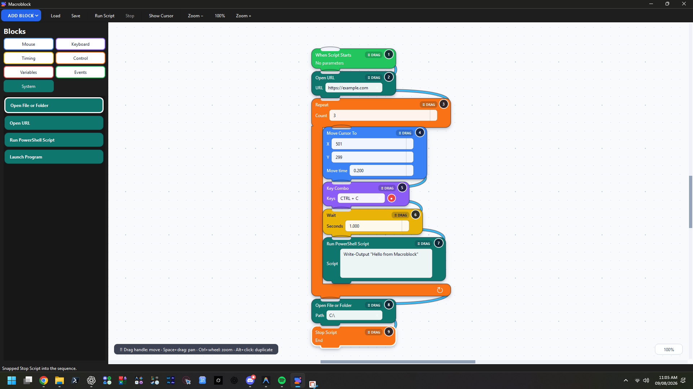

# Macroblock

Build useful Windows automations by snapping colorful blocks together—no programming required.



[](https://github.com/IamOumarIbrahim/macroblock-visual-automation/actions/workflows/ci.yml)
[](LICENSE)
[](https://www.microsoft.com/windows/)

[](https://github.com/IamOumarIbrahim/macroblock-visual-automation/releases/download/v0.1.0/Macroblock-Setup-0.1.0.exe)  
**[Download Macroblock Setup Wizard 0.1.0 for Windows (46 MB)](https://github.com/IamOumarIbrahim/macroblock-visual-automation/releases/download/v0.1.0/Macroblock-Setup-0.1.0.exe)**

Macroblock is a local visual automation app for Windows 10/11. Place action blocks on the canvas, snap them together, and run your automation. Scripts, coordinates, and typed text remain entirely local on your machine.

## Key Features

- **Mouse & Keyboard:** Move, click, drag, scroll, press keys, hotkeys, and text typing.
- **Flow Control:** Loops, conditions, fixed/random waits, and variables.
- **Triggers & System:** Hotkeys, file-wait events, launching apps/URLs, and inline PowerShell blocks.
- **Fail-Safe:** Hold **Esc for 0.5s** to abort any running automation immediately.

## Controls & Shortcuts

| Action | Control |
| :--- | :--- |
| Move stack / block | Drag **DRAG** handle |
| Add new block | **ADD BLOCK** button or double-click palette |
| Duplicate block / selection | **Alt + Click** / Right-click empty canvas |
| Record keystrokes | Click red record dot, press keys, release |
| Canvas Pan / Zoom | **Space + Drag** / **Ctrl + Scroll** |
| Emergency Stop | Hold **Esc for 0.5s** |

## Build from Source

```powershell
git clone https://github.com/IamOumarIbrahim/macroblock-visual-automation.git
cd macroblock-visual-automation
py -3.11 -m venv .venv
.\.venv\Scripts\python.exe -m pip install -e ".[dev]"
.\.venv\Scripts\python.exe -m macroblock
```

Run tests:
```powershell
.\.venv\Scripts\python.exe -m pytest
```

## Help the project

Did this help you? Please give it a **star**, so more people can find it. Bugs and ideas are welcome in [Issues](https://github.com/IamOumarIbrahim/macroblock-visual-automation/issues).

## License

Available under the [MIT License](LICENSE).
